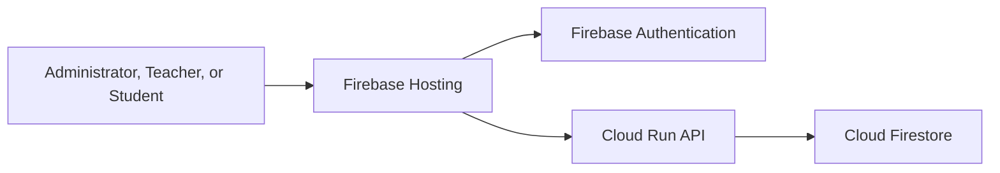

# AttendEase — Student Attendance Management System

AttendEase is a cloud-based website for managing student attendance. It provides separate portals for administrators, teachers, and students.

## Live website

**[Open AttendEase](https://attendease-demo-4684e.web.app)**

## Demo sign-in credentials

These credentials are for the project demonstration only. The teacher and student accounts must be created in the deployed Firebase project by the administrator before they can sign in.

| Role | Email | Password |
| --- | --- | --- |
| Administrator | `iamadmin@gmail.com` | `iamadmin` |
| Teacher (sample) | `meera.iyer@example.edu` | `12345678` |
| Student (sample) | `student01@example.edu` | `12345678` |

The password `12345678` is used for the demo teacher and student accounts. Do not reuse these demo passwords for personal or production accounts. Rotate or remove the demo credentials after the presentation.


## Features

- Role-based portals for administrators, teachers, and students
- Manage student and teacher records
- Organize classes and subjects
- Record attendance for class sessions
- Review attendance records and attendance summaries
- View attendance history in the student portal
- Responsive interface for desktop and mobile browsers

## Cloud architecture

AttendEase is deployed using Google Cloud and Firebase:

| Component | Service | Purpose |
| --- | --- | --- |
| Website | Firebase Hosting | Hosts the web application |
| Sign-in | Firebase Authentication | Authenticates users |
| Backend API | Cloud Run | Handles application requests |
| Database | Cloud Firestore | Stores user, academic, and attendance data |

The frontend sends API requests to the backend. The backend uses Firestore for application data and Firebase Authentication for user identity.



## Repository structure

```text
cloud-attendance-system/
├── backend/       # API, services, and tests
├── frontend/      # Website pages, styles, and browser code
├── scripts/       # Admin and sample-data scripts
├── firebase.json
├── firestore.rules
├── firestore.indexes.json
└── README.md
```

## Local development

The deployed website is available at the link above. To run the project locally, install Node.js and the Firebase CLI, then configure the Firebase project and local environment as described in the project configuration files.

Do not use production credentials or real student data for local testing.

## Deployment

The frontend is deployed to Firebase Hosting. The backend runs as a Cloud Run service, with Firestore as its database and Firebase Authentication for sign-in.

